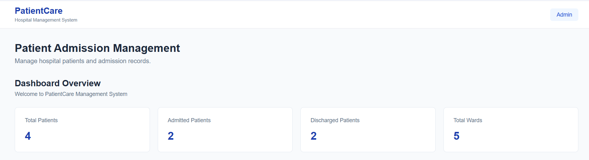
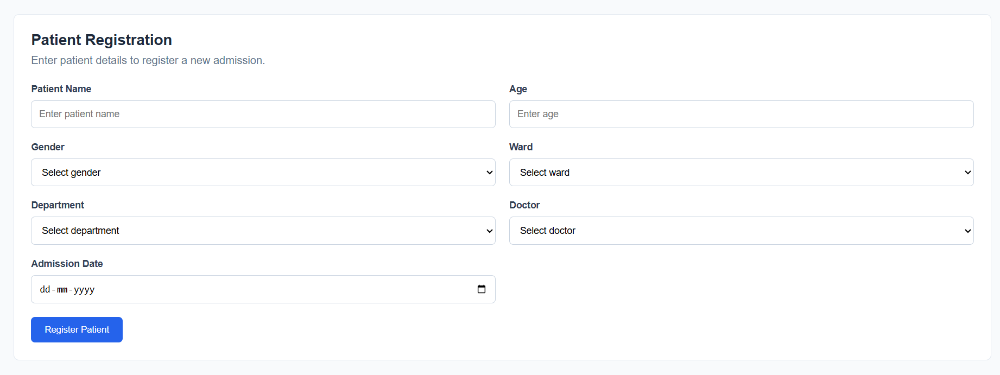
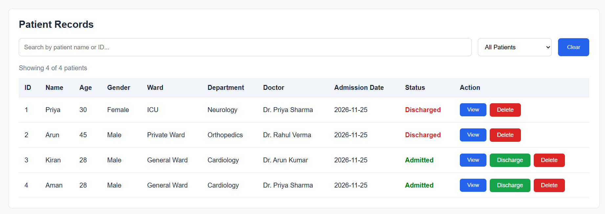
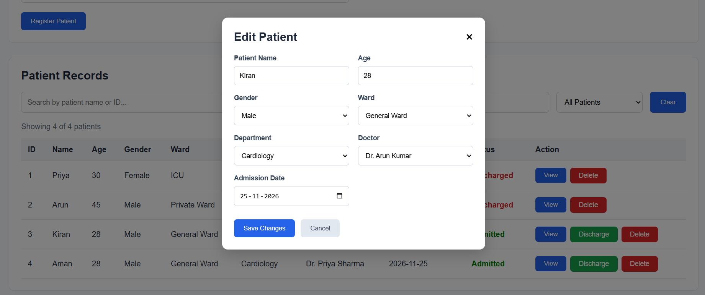

# Patient Admission Management System

A full-stack web application developed to manage hospital patient admissions and records.

## Features

- Register new patients
- View patient details
- Update patient information
- Delete patient records
- Discharge patients
- Search patients by name or ID
- Filter patients by admission status
- Dashboard with patient statistics
- Duplicate patient registration prevention

## Tech Stack

**Frontend:** React.js, JavaScript, HTML, CSS, Vite

**Backend:** Java, Spring Boot, Spring Data JPA, REST API

**Database:** MySQL

**Tools:** IntelliJ IDEA, MySQL Workbench, Postman, Git, GitHub

## Project Structure

```text
Patient-Admission-Management/
├── backend/
├── frontend/
├── screenshots/
└── README.md
```

## How to Run the Project

### 1. Clone the Repository

```bash
git clone https://github.com/YOUR_USERNAME/Patient-Admission-Management.git
```

### 2. Database Setup

- Open MySQL Workbench.
- Create a database for the project.
- Configure database credentials in `application.properties`.

### 3. Run Backend

```bash
cd backend
mvn spring-boot:run
```

Backend URL: `http://localhost:8080`

### 4. Run Frontend

Open another terminal:

```bash
cd frontend
npm install
npm run dev
```

Frontend URL: `http://localhost:5173`


## Screenshots

### Dashboard


### Patient Registration


### Patient Records


### Patient Details



## Author

**Chandan M L**

GitHub: https://github.com/ChandanML143